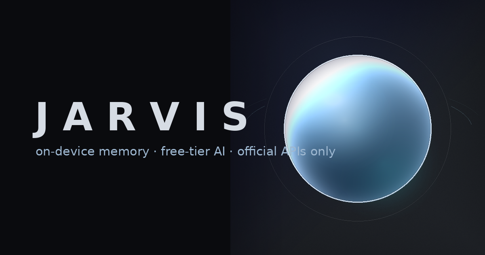

<div align="center">



**A native iOS assistant with on-device memory, honest integrations, and a free-tier AI core.**

Engine tests: **107 passing** · Backend tests: **112 passing** · Builds an **unsigned IPA** you sign yourself · **Zero cost**

</div>

---

## What this is

JARVIS is a real iOS app, not a mockup: a SwiftUI interface over a Foundation-only
Swift engine, with a durable memory of what you tell it, time-zone-aware
reminders, voice in and out, a tool engine that asks before it acts, and an
optional server component for the few jobs a phone should not do.

It is built around three rules:

1. **It never pretends.** No fake connectors, no simulated success, no invented
   data. If a capability is unconfigured or unpermitted, JARVIS says so and tells
   you what to do about it.
2. **It costs nothing to run.** No key ships in the app, no billing is ever
   enabled, and an exhausted free tier is reported rather than bypassed with a
   paid model.
3. **Your memory stays yours.** Records live in the app's container. Nothing is
   uploaded anywhere you did not configure.

## Highlights

| | |
|---|---|
| **11 screens** | Assistant Home (state-reactive orb), Conversation History, Memory Center, Reminders & Tasks, Connected Services, Tool Execution History, Project & Coding Agent, Settings, API & Provider Config, Permission Setup, Error & Recovery |
| **Dual memory** | Durable records with kinds, confidence, provenance and retention; ranked retrieval with stop-word filtering and pinned instructions; natural-language memory commands; JSON/Markdown/CSV export; correction history |
| **Real AI** | OpenAI-compatible and Gemini providers with streaming, cancellation, timeouts, bounded retries with jitter, and honest error taxonomy (401/403/429/5xx each get their own recovery advice) |
| **Tool engine** | 24 built-in tools, risk classes from `safe` to `irreversible`, argument validation, capability and permission gates, user confirmation for anything consequential, redacted audit log |
| **Official integrations only** | GitHub (REST + device flow), Gmail (Google OAuth + PKCE), Instagram (Graph, professional accounts), WhatsApp (official compose links and the Business Platform), Apple Calendar/Reminders (EventKit), web search |
| **Coding agent** | Reads a repository, drafts a plan, creates a branch, commits a document and opens a pull request — never force-pushes, never merges, never claims a build it did not run |
| **Security** | Keychain-only device secrets, backend-held privileged secrets, prompt-injection wrapping for external content, no secrets in the repo, logs, docs or IPA |
| **Premium design** | Liquid-glass surfaces, an orb that reflects real state and real audio, light and dark schemes, Dynamic Type, VoiceOver, Reduce Motion, haptics |

## Quick start

```bash
# Engine: build and test (works on Linux and macOS)
cd ios && swift build --build-tests && swift test --skip-build

# Everything at once, with a summary
./scripts/run_tests.sh

# Validate the repository (layout, structure, secrets scan)
./scripts/validate_project.sh

# iOS app (macOS + Xcode)
python3 scripts/generate_xcode_project.py && open ios/JarvisApp.xcodeproj

# Unsigned IPA — sign it with your own method afterwards
./scripts/build_unsigned_ipa.sh
```

The backend (optional, standard library only):

```bash
cd backend
JARVIS_BACKEND_TOKEN="$(python3 -c 'import secrets;print(secrets.token_urlsafe(32))')" \
  python3 -m app.main --host 127.0.0.1 --port 8787
```

## Repository map

```
ios/JarvisCore/Sources/JarvisCore/   Foundation-only engine (memory, context, providers, tools, reminders, agent)
ios/JarvisApp/                       SwiftUI app: App · Design · Features · Screens · Support · Resources
ios/JarvisTests/                     107 engine tests
backend/                             Optional stdlib-only Python service + 112 tests
assets/                              Generated icon, hero image, lockup
docs/                                PRODUCT_SPEC · ARCHITECTURE · DESIGN_SYSTEM · MEMORY_PROTOCOL · SECURITY ·
                                     FREE_TIER_POLICY · BUILD_GUIDE · INTEGRATIONS · TROUBLESHOOTING ·
                                     TEST_REPORT · DEFINITION_OF_DONE · SECTION_19_STATUS ·
                                     GET_THE_IPA
agent-memory/                        Engineering memory: constitution, state, decisions, backlog, issues, handoff
scripts/                             validate_project.sh · run_tests.sh · build_unsigned_ipa.sh ·
                                     verify_unsigned_ipa.sh · generate_app_icon.py · generate_xcode_project.py
```

## Documentation

* **[Getting the unsigned IPA](docs/GET_THE_IPA.md)** — the five-minute handover: what
  you do, what I need, and what I will never ask you for.
* **[Section 19 status report](docs/SECTION_19_STATUS.md)** — the short version: what is
  done, what is verified, and exactly what still needs a Mac.
* **[Test report](docs/TEST_REPORT.md)** — every executed test, with mocked vs live labelled.
* **[Definition of Done](docs/DEFINITION_OF_DONE.md)** — what is verified, what is
  not, and the exact commands for both. Start here to judge the project.
* [Product Specification](docs/PRODUCT_SPEC.md) · [Architecture](docs/ARCHITECTURE.md) ·
  [Design System](docs/DESIGN_SYSTEM.md) · [Memory Protocol](docs/MEMORY_PROTOCOL.md)
* [Security](docs/SECURITY.md) · [Free-Tier Policy](docs/FREE_TIER_POLICY.md)
* [Build Guide](docs/BUILD_GUIDE.md) · [Integrations](docs/INTEGRATIONS.md) ·
  [Troubleshooting](docs/TROUBLESHOOTING.md)

## Free tier, honestly

Primary provider: **Groq** (`openai/gpt-oss-120b`, ~30 req/min, 1,000 req/day, no
card). Secondary: **Google AI Studio** (`gemini-2.5-flash`, free tier, prompts may
be used to improve Google products outside the EEA/UK). Tertiary: **OpenRouter**
`:free` models (~50 req/day). Or run **Ollama** locally and pay nothing ever.
Terms were verified on **2026-10-16** and every entry records that date — free
tiers change, so check before relying on them. Details: [docs/FREE_TIER_POLICY.md](docs/FREE_TIER_POLICY.md).

## Scope and limitations

Stated up front, because a project that hides these is not trustworthy:

* The SwiftUI layer is written and parse-checked, but has never been compiled — no
  macOS or Xcode was available during development. The first Xcode build is the
  real gate. The engine beneath it is tested on every commit.
* Retrieval uses a lexical embedder by default. It is honest about that, and a
  semantic embedder can be dropped in.
* No unofficial access to WhatsApp personal chats or Instagram DMs — no official
  API exists for them, so JARVIS does not offer a workaround.
* The bundled backend has no push-notification credentials; it dispatches through
  a webhook you own.
* iOS background execution is not assumed anywhere.

## Licence

Original work, no third-party assets, no trademarks. Use and modify it as you see
fit; you are responsible for the terms of the providers you connect.
